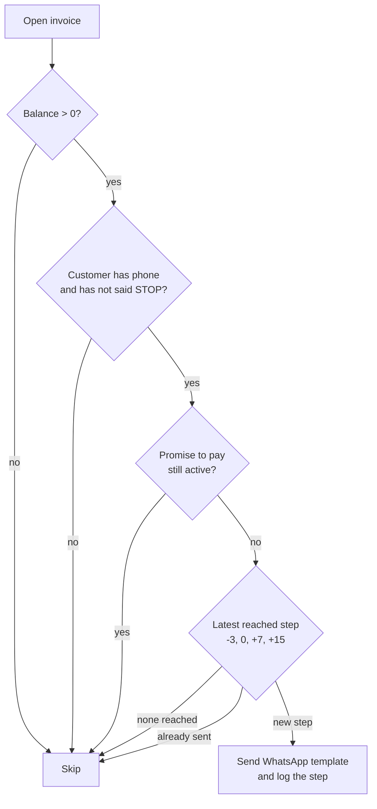

# System Requirements Specification (SRS)

| | |
|---|---|
| Product | PayRemind |
| Version | 0.1 (matches code at milestone M4) |
| Date | 26 Nov 2026 |
| Related | [BRD](01-business-requirements.md) · [Tech spec](03-technical-specification.md) · [API](05-api-reference.md) |

## 1. How to read this document

Each requirement has an ID, a plain statement using **must** or **should**, and a status:

- **Built**: implemented and covered by tests on `main`.
- **Partial**: implemented in part; the gap is described.
- **Planned**: not built yet; the milestone is named.
- **Gap**: found while writing this document; not yet planned anywhere.

"Verified by" names the test file that checks the requirement, where one exists.

## 2. System overview

PayRemind is a single Python web application (FastAPI) with a PostgreSQL database, a daily
command-line job, and three outside services: Meta's WhatsApp Cloud API, Razorpay and the
customer's UPI app. See the [system context diagram](diagrams/01-system-context.svg).

### 2.1 Users and roles

| Role | How they authenticate | What they can do |
|---|---|---|
| Merchant user | Phone number + 6-digit code sent on WhatsApp; then a session cookie | Everything in the dashboard for their own business |
| API client | Bearer token issued once at invite time | Upload, list, ageing, promises, mark paid, run reminders for one business |
| Customer (buyer) | None; holds an unguessable pay link | View one invoice's pay page |
| Operator | Shell access to the server | Invite businesses, add users, run migrations and the daily job |
| Meta, Razorpay | HMAC signature on each webhook | Report STOP replies; report subscription events |

## 3. Functional requirements

### 3.1 Onboarding (invite-only)

| ID | Requirement | Status | Verified by |
|---|---|---|---|
| FR-ON-1 | The operator must create a business with a name, UPI ID, payee name and owner mobile number using `payremind invite`. | Built | test_api (test_cli) |
| FR-ON-2 | The system must reject an invalid UPI ID or a number that is not a valid Indian mobile. | Built | test_core |
| FR-ON-3 | The system must print the business's API token exactly once and store only its SHA-256 hash. | Built | — |
| FR-ON-4 | New businesses must get a 30-day trial by default; `--trial-days 0` must create a complimentary account with no expiry. | Built | test_billing |
| FR-ON-5 | The operator must be able to let another phone number sign in to a business (`payremind add-user`). | Built | — |
| FR-ON-6 | There must be no public sign-up during the beta. | Built | — |
| FR-ON-7 | The operator should be able to revoke or rotate a business's API token. | Gap | — |

### 3.2 Sign-in and sessions

| ID | Requirement | Status | Verified by |
|---|---|---|---|
| FR-AU-1 | A user must sign in by entering their mobile number and then a 6-digit code sent as a WhatsApp authentication template. | Built | test_auth_web |
| FR-AU-2 | A code must expire after 5 minutes and allow at most 5 guesses. | Built | test_auth_web |
| FR-AU-3 | At most 3 codes may be issued per phone number in any 15 minutes. | Built | test_auth_web |
| FR-AU-4 | The response to "send me a code" must look the same whether or not the number belongs to a user. | Built | test_auth_web |
| FR-AU-5 | Codes must be stored only as keyed HMAC-SHA256 hashes; session tokens only as SHA-256 hashes. | Built | — |
| FR-AU-6 | Sessions must last 7 days, use an HttpOnly, Secure, SameSite=Lax cookie, and end on logout. | Built | test_auth_web |
| FR-AU-7 | Every state-changing dashboard form must carry the session's CSRF token, compared in constant time. | Built | test_auth_web |
| FR-AU-8 | Sign-in attempts should also be rate-limited per IP address. | Planned (Terraform written, not applied: WAF limit of 20 requests per IP per 5 min on login) | — |
| FR-AU-9 | Expired codes and sessions should be deleted periodically. | Gap | — |

### 3.3 Import

| ID | Requirement | Status | Verified by |
|---|---|---|---|
| FR-IM-1 | The system must accept `.xlsx` and `.csv` files up to 5 MB and 5,000 data rows, and reject other types with a clear message. | Built | test_importer, test_api |
| FR-IM-2 | The system must find the header row within the first 15 rows, so title lines in Tally exports are skipped. | Built | test_importer |
| FR-IM-3 | The system must recognise common header spellings (for example "Party Name", "Bill No", "Pending Amount", "Due On"). Required columns: customer, invoice number, due date, balance. Optional: phone, invoice date, amount, language. | Built | test_importer |
| FR-IM-4 | The system must read dates in the common Indian formats (`dd-mm-yyyy`, `dd/mm/yyyy`, `dd-Mon-yyyy`, `dd.mm.yyyy`, ISO) and amounts with commas, ₹ and Dr/Cr suffixes. | Built | test_importer |
| FR-IM-5 | Bad rows must be skipped and reported with their row number and reason; good rows must still import. | Built | test_importer |
| FR-IM-6 | A duplicate invoice number within one file must be reported as an error. | Built | test_importer |
| FR-IM-7 | Phone numbers must be normalised to `+91XXXXXXXXXX`; invalid numbers must become "no phone" rather than fail the row. | Built | test_core |
| FR-IM-8 | Re-uploading must update existing invoices (matched by invoice number within the business) instead of creating duplicates. A zero balance must mark the invoice paid. | Built | test_api |
| FR-IM-9 | A language column with `hi`, `hindi` or `हिंदी` must select Hindi reminders for that customer. | Built | test_importer |
| FR-IM-10 | Corrupt files must return a generic error and never echo internal details. | Built | test_api |

### 3.4 Receivables view

| ID | Requirement | Status | Verified by |
|---|---|---|---|
| FR-RV-1 | The system must list open invoices, most overdue first, with days overdue. | Built | test_api |
| FR-RV-2 | The system must total open balances into five ageing buckets: not due, 1–30, 31–60, 61–90 and 90+ days late. | Built | test_core |
| FR-RV-3 | "Today" must be the date in India (Asia/Kolkata), not UTC. | Built | — |

### 3.5 Reminders

| ID | Requirement | Status | Verified by |
|---|---|---|---|
| FR-RM-1 | Reminders must be due at these offsets from the due date: −3, 0, +7 and +15 days. | Built | test_core |
| FR-RM-2 | Each invoice must get at most one reminder per offset, enforced by a unique database key, so re-running the job is safe. | Built | test_core, test_api |
| FR-RM-3 | If a run was missed, the job must send only the latest reached offset, not all missed ones. | Built | test_core |
| FR-RM-4 | No reminder may be sent when the invoice is paid, the customer has no phone, the phone has opted out, or a promise to pay is active (today on or before the promised date). | Built | test_core |
| FR-RM-5 | No reminder may be sent for a business whose trial has ended or whose subscription is halted, paused or cancelled. "Past due" (Razorpay still retrying) still sends. | Built | test_billing |
| FR-RM-6 | Each reminder must use the approved template `payment_reminder_v1` with four values: customer name, invoice number, amount in ₹, pay page link. | Built | test_whatsapp |
| FR-RM-7 | The daily job (`payremind run-reminders`) must run for every business in good standing and report businesses, sent and failed. | Built | test_api |
| FR-RM-8 | A failed send must be counted and retried on the next run (it is not logged as sent). | Built | test_api |
| FR-RM-9 | The daily job must run automatically at 09:30 IST. | Planned (Terraform written, not applied: EventBridge Scheduler starts a one-off Fargate task) | — |
| FR-RM-10 | A merchant must be able to trigger "send due reminders now"; it must obey the same rules. | Built | test_api, test_auth_web |

### 3.6 Pay page

| ID | Requirement | Status | Verified by |
|---|---|---|---|
| FR-PP-1 | Each invoice must have a random, unguessable pay token (24 random bytes) separate from its database id. | Built | test_paypage |
| FR-PP-2 | `/p/<token>` must show payee name, UPI ID, invoice number, due date and balance, with a `upi://pay` button and a QR code for the same link. | Built | test_paypage |
| FR-PP-3 | The UPI link must pay the merchant's own UPI ID with the exact balance (₹0.01 to ₹10,00,000) and reference the invoice number. | Built | test_core |
| FR-PP-4 | A paid invoice's page must say it is paid and show no payment button. | Built | test_paypage |
| FR-PP-5 | An unknown or malformed token must return a plain 404. | Built | test_paypage |
| FR-PP-6 | The page must send strict security headers (CSP with no scripts, no-referrer, noindex, no-store). | Built | test_paypage |

### 3.7 Promises and payment status

| ID | Requirement | Status | Verified by |
|---|---|---|---|
| FR-PS-1 | A merchant must be able to record a promise-to-pay date (today or later), amount and short note against an invoice. | Built | test_api, test_auth_web |
| FR-PS-2 | A merchant must be able to mark an invoice paid, which sets its balance to zero. | Built | test_api |
| FR-PS-3 | Partial payments should be recordable without re-uploading. | Gap | — |

### 3.8 Opt-out

| ID | Requirement | Status | Verified by |
|---|---|---|---|
| FR-OO-1 | The WhatsApp webhook must verify Meta's `X-Hub-Signature-256` before reading the body. | Built | test_webhook |
| FR-OO-2 | A text or button reply of STOP, UNSUBSCRIBE, STOP REMINDERS, BAND KARO or बंद करो must opt that number out for every business. | Built | test_webhook |
| FR-OO-3 | The webhook subscription handshake must succeed only with the configured verify token. | Built | test_webhook |
| FR-OO-4 | A customer should be able to opt back in (for example by replying START). | Gap | — |

### 3.9 Billing (PayRemind's own fee)

| ID | Requirement | Status | Verified by |
|---|---|---|---|
| FR-BL-1 | A merchant must enter legal name, state and address (GSTIN optional, checksum-validated) before subscribing. | Built | test_billing, test_gst |
| FR-BL-2 | A merchant must choose Starter or Growth and pay on Razorpay's hosted page. | Built | test_billing |
| FR-BL-3 | The Razorpay webhook must verify the HMAC signature and process each event id only once. | Built | test_billing |
| FR-BL-4 | Subscription events must update the business's billing status (active, past due, halted, paused, cancelled). | Built | test_billing |
| FR-BL-5 | Every successful charge must create one GST invoice numbered `PR/<FY>/<nnnnn>`, splitting the GST-inclusive amount into CGST+SGST (same state) or IGST (other state), or no GST while PayRemind is unregistered. | Built | test_billing, test_gst |
| FR-BL-6 | The invoice must keep a snapshot of the buyer's details at issue time. | Built | test_billing |
| FR-BL-7 | Cancelling must take effect at the end of the current billing cycle. | Built | test_billing |
| FR-BL-8 | Plan limits shown to merchants (200 customers on Starter, 1,000 on Growth, Hindi on Growth) should be enforced. | Gap | — |

### 3.10 Legal pages

| ID | Requirement | Status |
|---|---|---|
| FR-LG-1 | `/privacy` and `/terms` must be reachable without sign-in. | Built (drafts) |
| FR-LG-2 | Privacy policy, terms and DPA must be reviewed by a lawyer before public launch. | Planned (launch gate) |
| FR-LG-3 | A merchant should be able to export and delete their data (the DPA promises help with this). | Gap |

## 4. Non-functional requirements

| ID | Category | Requirement | Status |
|---|---|---|---|
| NFR-1 | Security | All traffic must use HTTPS in production; cookies must be Secure. | Built in app; HTTPS + HSTS at CloudFront and TLS to the database (Terraform written, not applied) |
| NFR-2 | Security | One business must never read, change or message another business's data. Tenant-isolation tests must pass 100%. | Built (test_tenant_isolation) |
| NFR-3 | Security | CI must pass ruff, mypy strict, bandit and pip-audit; CodeQL/Semgrep and OWASP ZAP must show no open high or critical issues before launch. | Partial: first four in CI; scans planned |
| NFR-4 | Quality | Test coverage must stay at or above 80% (currently about 99% overall). | Built (CI gate) |
| NFR-5 | Privacy | Data must be stored in India (ap-south-1) and encrypted at rest. | Planned (Terraform written, not applied) |
| NFR-6 | Logging | Security-relevant logs must be kept at least 180 days. **⚖ Verify** CERT-In requirements. | Planned (Terraform written, not applied: 365 days); the app itself has no structured logging yet (gap) |
| NFR-7 | Availability | Beta target: the dashboard is usually available; the daily job completes every day. No formal SLA. | Planned |
| NFR-8 | Performance | The daily job should finish within a few minutes for 20 businesses × 5,000 invoices. Load-test before launch. | Planned (launch gate) |
| NFR-9 | Recovery | Automated backups; a restore must be tested before launch. Target RPO 24 hours, RTO 4 hours for the beta. | Planned (Terraform written, not applied: 7-day backups with point-in-time restore) |
| NFR-10 | Incident response | A runbook must make it possible to report a reportable incident to CERT-In within 6 hours. **⚖ Verify** | Planned (launch gate) |
| NFR-11 | Cost | Monthly AWS cost for the beta should stay near the ~$70–82 estimate, with budget alerts at 50% and 100% of $100. | Planned (Terraform written, not applied) |
| NFR-12 | Usability | The dashboard must work on a phone browser without JavaScript builds; Hindi and English for reminders. | Built |
| NFR-13 | Maintainability | Schema changes must go through Alembic migrations, tested up and down. | Built (test_migrations) |
| NFR-14 | Portability | The app must run locally with SQLite and no outside accounts (fake WhatsApp and Razorpay adapters). | Built |

## 5. External interfaces

| Interface | Direction | Protocol | Auth |
|---|---|---|---|
| Merchant browser | In | HTTPS, HTML forms | OTP + session cookie + CSRF |
| API client | In | HTTPS, JSON | Bearer token |
| Customer browser | In | HTTPS, HTML | Pay token in URL |
| Meta webhook | In | HTTPS, JSON | HMAC-SHA256 (`X-Hub-Signature-256`) |
| Razorpay webhook | In | HTTPS, JSON | HMAC-SHA256 (`X-Razorpay-Signature`), event id dedupe |
| Meta Graph API | Out | HTTPS, JSON | Bearer access token |
| Razorpay API | Out | HTTPS, JSON | Basic auth (key id + secret) |
| PostgreSQL | Out | PostgreSQL wire protocol (TLS in production) | Username and password (IAM later) |

Details of each route are in the [API reference](05-api-reference.md).

## 6. Traceability to business requirements

| Business item (BRD) | Requirements |
|---|---|
| S-1 Import | FR-IM-1 … FR-IM-10 |
| S-2 Ageing | FR-RV-1 … FR-RV-3 |
| S-3 Reminder schedule | FR-RM-1 … FR-RM-10 |
| S-4 Pay page | FR-PP-1 … FR-PP-6 |
| S-5 Promises, mark paid | FR-PS-1 … FR-PS-3 |
| S-7 Opt-out, BR-2 | FR-OO-1 … FR-OO-4 |
| S-8 Dashboard sign-in | FR-AU-1 … FR-AU-9 |
| S-9 Billing, BR-5, BR-8, BR-9 | FR-BL-1 … FR-BL-8, FR-RM-5 |
| BR-1 Money goes direct | FR-PP-3 |
| BR-6 Isolation | NFR-2 |
| S-11 AWS | NFR-1, NFR-5, NFR-6, NFR-9, NFR-11 |
