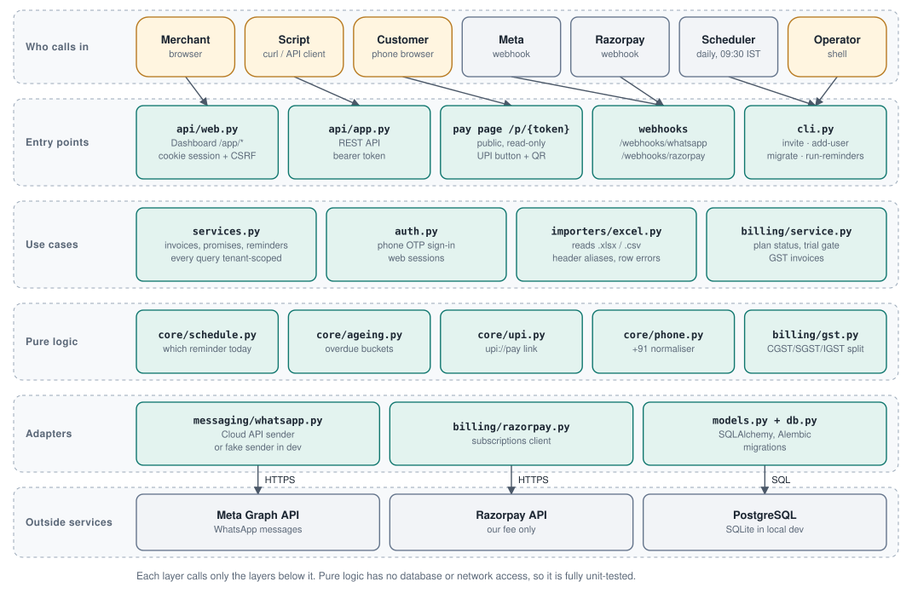
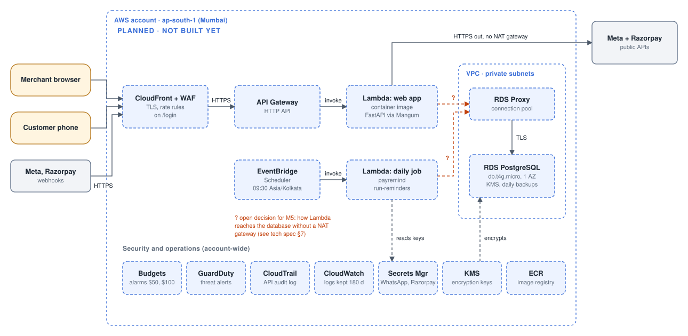

# Technical Specification

| | |
|---|---|
| Product | PayRemind |
| Version | 0.1 (code at milestone M4; AWS section is a plan) |
| Date | 26 Nov 2026 |
| Related | [SRS](02-system-requirements.md) · [Data model](04-data-model.md) · [Security](06-security-and-compliance.md) |

## 1. Summary

PayRemind is one Python service. A FastAPI app serves a server-rendered dashboard, a small JSON
API, a public pay page and two webhooks. A command-line tool (`payremind`) handles invites,
migrations and the daily reminder run. Data lives in PostgreSQL (SQLite for local development).
WhatsApp messages go through Meta's Cloud API; PayRemind's own fee goes through Razorpay
Subscriptions. Customers pay merchants directly with UPI, so no money touches PayRemind.



## 2. Technology choices

| Area | Choice | Why |
|---|---|---|
| Language | Python 3.12+ (CI and Docker use 3.13) | Owner's learning goal; good libraries for files, HTTP and data |
| Web framework | FastAPI + Uvicorn | Typed request handling, dependency injection for auth and sessions |
| Templates | Jinja2 with autoescape, plain HTML forms, inline CSS | No JavaScript build; strict CSP possible (no scripts at all) |
| ORM and migrations | SQLAlchemy 2.0 (typed `Mapped` models) + Alembic | Portable between SQLite and PostgreSQL; reviewed schema changes |
| Database driver | psycopg 3 | Current PostgreSQL driver |
| Spreadsheet parsing | openpyxl (read-only mode) and the standard `csv` module | Handles Excel and Tally exports |
| QR codes | segno (SVG output, embedded as a data URI) | Pure Python, no image libraries |
| HTTP client | httpx | Timeouts, easy to fake in tests |
| Config | pydantic-settings, `PAYREMIND_*` environment variables | Typed settings, 12-factor style |
| Quality | pytest + coverage (80% gate), ruff, mypy `--strict`, bandit, pip-audit | Run in CI on every push |

## 3. Code layout

```
src/payremind/
  api/app.py          FastAPI factory: JSON API, pay page, webhooks; wires everything
  api/web.py          Dashboard routes: login, upload, promises, mark paid, billing
  api/templates/      Jinja2 pages (dashboard, login, pay, billing, GST invoice, legal)
  auth.py             Phone OTP and web sessions
  services.py         Use cases; every query takes a tenant and filters by tenant_id
  importers/excel.py  .xlsx/.csv parser with header aliases and per-row errors
  core/               Pure logic, no I/O: schedule, ageing, upi, phone
  billing/gst.py      Pure GST maths, GSTIN validation, invoice numbering
  billing/service.py  Plans, subscription status, webhook handling, GST invoice issue
  billing/razorpay.py Razorpay client (and a fake for tests)
  messaging/whatsapp.py  Sender protocol, Cloud API sender, fake sender
  models.py, db.py    SQLAlchemy models and engine
  migrations/         Alembic revisions 0001–0003
  security.py         Token generation, hashing, signature checks
  cli.py              invite, add-user, migrate, run-reminders
tests/                95 tests: unit, API, web, webhooks, billing, migrations, tenant isolation
```

### 3.1 Design rules the code follows

1. **Pure core.** `core/` and `billing/gst.py` take values and return values. They never touch
   the database, the clock or the network, so they are fully unit-tested.
2. **Tenant always explicit.** Every function in `services.py` takes the `Tenant` and adds
   `tenant_id == tenant.id` to every query. Lookups by id use `id AND tenant_id`, so another
   business's id returns "not found" (404), never "forbidden" (which would confirm it exists).
3. **Adapters behind protocols.** `Sender` and `BillingGateway` are protocols with real and fake
   implementations. The app picks the real one only when credentials are configured.
4. **Clock injected.** `create_app` takes `today()` and `now()` functions, so tests control time.
   Business dates use India time (`Asia/Kolkata`); token expiries use Unix seconds.
5. **Idempotency by unique keys.** Reminder log `(tenant_id, invoice_id, offset_days)`, processed
   webhook `event_id`, billing invoice `razorpay_payment_id`. Retries cannot double-act.

## 4. Key flows

### 4.1 Import

1. `POST /imports` (API) or `POST /app/upload` (dashboard) reads at most 5 MB + 1 byte.
2. `parse_invoices` reads the first worksheet or the CSV, scans the first 15 rows for a header,
   maps aliases to fields, and parses each row. Bad rows go into `errors` with a row number.
3. `services.import_rows` upserts customers by `(tenant_id, name)` and invoices by
   `(tenant_id, number)`. A zero balance sets the status to paid. One commit at the end.

### 4.2 Daily reminder run

`payremind run-reminders` (scheduled at 09:30 IST in production) calls `run_all_tenants`:

1. For each tenant where `can_send(tenant, today)` is true (trial still valid, or subscription
   active or past due):
2. Load all opted-out phones once. For each open invoice, load the steps already sent and the
   latest promise date, and build an `InvoiceState`.
3. `core.schedule.due_offset` returns the latest reached step not yet sent, or nothing.
4. Send the `payment_reminder_v1` template in the customer's language with a link to
   `PUBLIC_BASE_URL/p/<pay_token>`.
5. On success, insert a `ReminderLog` row and commit (one commit per message, so a crash halfway
   does not resend what already went). On `SendError`, count a failure and move on; the step is
   tried again next run.

See the [data flow diagram](diagrams/03-data-flow.svg) for the whole path from upload to payment.

### 4.3 Sign-in

1. `POST /login` with a phone number. If it belongs to a user and fewer than 3 codes were issued
   in 15 minutes, store `HMAC(secret_key, phone:code)` with a 5-minute expiry and send the code
   using the `login_code_v1` template. The page looks the same in every case.
2. `POST /login/verify` checks the newest unconsumed, unexpired code, allowing 5 attempts.
3. On success, create a `WebSession` (random token, stored as SHA-256; random CSRF token) and set
   the `pr_session` cookie (HttpOnly, Secure, SameSite=Lax, 7 days).

### 4.4 Billing

1. The merchant saves billing details, picks a plan and is sent to Razorpay's hosted page
   (`short_url`). The subscription id is stored on the tenant.
2. Razorpay calls `POST /webhooks/razorpay`. The app checks the HMAC of the raw body, skips event
   ids already processed, maps the event to a status, and on `subscription.charged` issues a GST
   invoice: the charged amount is treated as GST-inclusive and split 9% + 9% (same state as the
   supplier, Karnataka by default) or 18% IGST. No GST is applied until `SUPPLIER_GSTIN` is set.
3. Invoice numbers are `PR/<FY>/<5-digit sequence>`, restarting each Indian financial year.

> **Note on prices.** The code shows ₹999 and ₹2,499 as prices before GST, while the Razorpay
> plans are expected to charge GST-inclusive amounts. The Razorpay plan amounts must therefore be
> set to the price plus GST once registered (for example ₹1,178.82 for Starter at 18%).
> **⚖ Verify** pricing display and GST treatment with a CA.

## 5. Configuration

All settings are environment variables with the `PAYREMIND_` prefix (see `.env.example`).

| Variable | Purpose | Secret? |
|---|---|---|
| `DATABASE_URL` | SQLAlchemy URL (SQLite locally, PostgreSQL in production) | Yes (contains password) |
| `WHATSAPP_TOKEN`, `WHATSAPP_PHONE_NUMBER_ID` | Meta Cloud API sender; empty means fake sender | Token yes |
| `WHATSAPP_APP_SECRET` | Verifies Meta webhook signatures | Yes |
| `WHATSAPP_VERIFY_TOKEN` | Webhook subscription handshake | Yes |
| `PUBLIC_BASE_URL` | Used to build pay page links | No |
| `SECRET_KEY` | Keys OTP hashes. **Must be set in production**; if empty a random key is used and pending codes break on restart | Yes |
| `COOKIE_SECURE` | `false` only for local http | No |
| `SESSION_DAYS` | Session lifetime (default 7) | No |
| `RAZORPAY_KEY_ID`, `RAZORPAY_KEY_SECRET` | Razorpay API | Secret yes |
| `RAZORPAY_WEBHOOK_SECRET` | Verifies Razorpay webhooks | Yes |
| `RAZORPAY_PLAN_STARTER`, `RAZORPAY_PLAN_GROWTH` | Plan ids from the Razorpay dashboard | No |
| `SUPPLIER_NAME`, `SUPPLIER_GSTIN`, `SUPPLIER_STATE_CODE`, `SUPPLIER_ADDRESS` | PayRemind's details on GST invoices | No |
| `MAX_UPLOAD_BYTES`, `MAX_IMPORT_ROWS` | Import limits (5 MB, 5,000 rows) | No |

## 6. Build, test and release

- `make install`, `make check` (ruff, format check, mypy strict, bandit, pip-audit), `make test`.
- CI (GitHub Actions) runs the same on every push and pull request, with read-only permissions.
- Tests run on SQLite by default; set `PAYREMIND_TEST_DATABASE_URL` to run them on PostgreSQL.
- `Dockerfile`: `python:3.13-slim`, installs the package, runs as non-root user `app` (uid 10001),
  starts Uvicorn on port 8000. Run `payremind migrate` before starting a new version.
- Branching: feature branches and pull requests into `main`; one PR per milestone so far.

## 7. Planned AWS deployment (M5, not built)

> Nothing in this section exists yet. Creating any AWS resource needs Hari's go-ahead.



| Concern | Plan (from PLAN.md) |
|---|---|
| Region | ap-south-1 (Mumbai), single account |
| Edge | CloudFront with AWS WAF; WAF rate rule on `/login` and `/login/verify` per IP |
| Compute | Lambda from a container image (ECR), FastAPI wrapped with Mangum, behind API Gateway HTTP API |
| Daily job | EventBridge Scheduler, timezone Asia/Kolkata, 09:30, invokes a Lambda running `run-reminders` |
| Database | RDS PostgreSQL `db.t4g.micro`, single-AZ for beta, KMS encryption, automated backups |
| Secrets | Secrets Manager for WhatsApp and Razorpay keys and `SECRET_KEY` |
| Logging and detection | CloudWatch Logs kept 180 days, CloudTrail, GuardDuty |
| Cost | Target $50–150 a month; AWS Budgets alarms at $50 and $100 |
| IaC | Terraform |

### 7.1 Open decision: reaching the database without a NAT gateway

The plan wants no NAT gateway, to save money. That creates a real constraint:

- A Lambda **outside** a VPC can call Meta and Razorpay over the internet, but cannot reach a
  database in private subnets (RDS Proxy is also VPC-only).
- A Lambda **inside** a VPC can reach the database, but has no internet access without a NAT
  gateway or another egress path.

The reminder job needs both: it reads the database and calls WhatsApp. Options to compare in M5,
with the AWS pricing calculator (all prices below are rough and **need checking**):

| Option | How it works | Cost and effort | Security notes |
|---|---|---|---|
| A. Managed NAT gateway | Lambda in private subnets, NAT gateway in a public subnet | Simplest; roughly $40+ a month plus data processing in Mumbai | Standard pattern; easy to explain in interviews |
| B. NAT instance | A tiny EC2 instance (for example t4g.nano with an open-source NAT image) instead of the managed gateway | A few dollars a month; you patch and monitor it | One more server to harden; a good networking exercise |
| C. IPv6 egress-only gateway | Dual-stack subnets; Lambda reaches IPv6 endpoints through a free egress-only internet gateway | Cheap, but **only works if Meta's and Razorpay's API hosts support IPv6**; verify first | Outbound-only by design |
| D. Split the job with a queue | A VPC Lambda reads the database and puts messages on SQS; a non-VPC Lambda sends them and reports results back | SQS VPC endpoint costs money; more moving parts | Clean separation of database and internet access |
| E. Aurora Serverless v2 with the Data API | Lambda stays outside the VPC and talks to the database over HTTPS with IAM | Needs a different SQLAlchemy driver and some code changes; check minimum cost | No database port exposed at all |
| F. Public RDS endpoint | Database reachable from the internet with TLS and strong credentials | Cheap | **Not recommended**: Lambda has no fixed IPs, so the firewall cannot be tight |

**Suggested starting point:** compare A and B on cost; if Meta and Razorpay both support IPv6,
C is the cheapest clean answer. Record the choice as an architecture decision in this document.

### 7.2 Other M5 items

- `SECRET_KEY` must come from Secrets Manager; add a start-up check that refuses to run in
  production without it.
- Lambda should load secrets once per cold start, not per request.
- Add structured JSON logging (request id, tenant id, route, status, no personal data) so
  CloudWatch can be searched during an incident. The app has no logging today.
- Health check `/health` for monitoring.

## 8. Known technical gaps (found while writing)

| # | Gap | Suggested fix |
|---|---|---|
| G-1 | No application logging or audit trail (who marked what paid, who logged in) | Structured logging plus an `audit_events` table |
| G-2 | API bearer tokens never expire and cannot be rotated | `payremind rotate-token`; optional expiry |
| G-3 | Plan limits (customers, Hindi on Growth) are displayed but not enforced | Check in `import_rows` and when sending |
| G-4 | GST invoice numbers use "count + 1"; two charges at the same moment could collide (the unique key rejects one, and Razorpay retries) | A database sequence or a locked counter row per FY |
| G-5 | Expired OTP challenges and sessions are never deleted | Clean-up step in the daily job |
| G-6 | openpyxl parses untrusted XML; it is safer with `defusedxml` installed, and a 5 MB `.xlsx` can expand a lot when unzipped | Add `defusedxml`; cap uncompressed size |
| G-7 | No opt-in (START) after STOP | Handle START in the webhook |
| G-8 | No partial payments; mark-paid sets balance to zero | `POST /invoices/{id}/payments` with an amount |
| G-9 | No data export or delete for a merchant, although the DPA promises help | Operator CLI first, then a dashboard button |
| G-10 | `SECRET_KEY` silently falls back to a random value | Fail fast when unset outside development |
