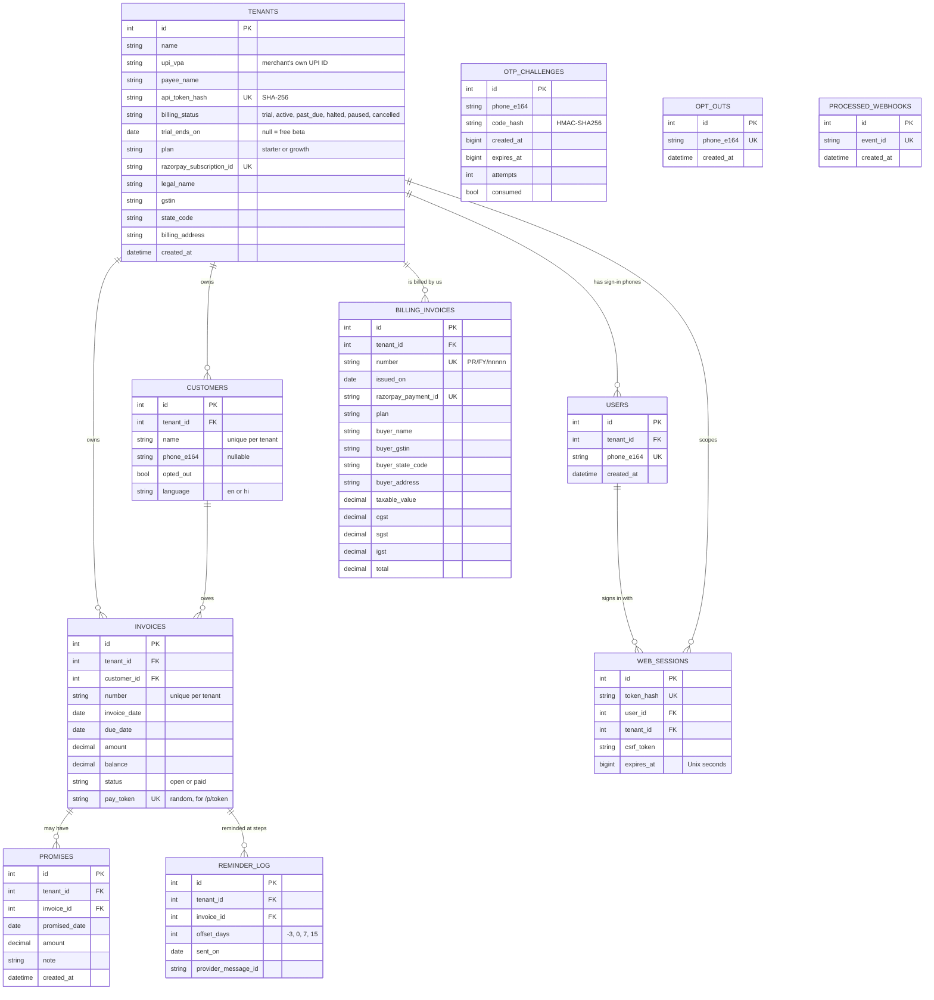

# Data Model

Source of truth: `src/payremind/models.py` and the Alembic migrations `0001`–`0003`. This page
explains the tables in plain language. If they ever disagree, the code wins; please update this
page in the same pull request as the migration.

## 1. Entity relationship diagram

GitHub renders this diagram. To edit it in draw.io, use *Arrange → Insert → Advanced → Mermaid*
and paste the code block.

`OTP_CHALLENGES`, `OPT_OUTS` and `PROCESSED_WEBHOOKS` are keyed by phone number or event id, not
by tenant, so they stand alone in the diagram.

## 2. Tables in plain language

| Table | One row is… | Belongs to a tenant? | Personal data? |
|---|---|---|---|
| `tenants` | A merchant business using PayRemind | It *is* the tenant | Business name, UPI ID, billing address, GSTIN |
| `users` | A phone number allowed to sign in to a business | Yes | Phone number |
| `customers` | One of the merchant's customers | Yes | Name, phone number, language |
| `invoices` | One unpaid (or paid) invoice from an upload | Yes | Amounts linked to a named customer |
| `promises` | A promise to pay by a date | Yes | Free-text note may contain personal data |
| `reminder_log` | One reminder that was sent | Yes | Links a person to a debt and a date |
| `opt_outs` | A phone number that replied STOP | No (applies to all) | Phone number |
| `otp_challenges` | One login code, stored as a hash | No | Phone number |
| `web_sessions` | One signed-in browser | Yes | None directly |
| `billing_invoices` | PayRemind's GST invoice to a merchant | Yes | Buyer details (snapshot) |
| `processed_webhooks` | A Razorpay event already handled | No | None |

## 3. Keys and constraints that carry business rules

| Constraint | Rule it enforces |
|---|---|
| `customers (tenant_id, name)` unique | A customer is identified by name within one business; uploads update rather than duplicate |
| `invoices (tenant_id, number)` unique | Re-uploading the same invoice number updates it; two businesses can use the same numbers |
| `invoices.pay_token` unique | Each pay link points to exactly one invoice |
| `reminder_log (tenant_id, invoice_id, offset_days)` unique | At most one reminder per invoice per step, even if the job runs twice |
| `opt_outs.phone_e164` unique | One opt-out per number, applied to every business |
| `users.phone_e164` unique | One phone signs in to exactly one business |
| `processed_webhooks.event_id` unique | Each Razorpay event is applied once |
| `billing_invoices.razorpay_payment_id` unique | One GST invoice per payment |
| `billing_invoices.number` unique | No duplicate invoice numbers |

## 4. Money and dates

- Money is `NUMERIC(14, 2)` in rupees and `Decimal` in Python. Never floats.
- Business dates (due date, promise date, "today") are calendar dates in India time.
- Expiry times for codes and sessions are Unix seconds (UTC) in `BIGINT` columns.
- `created_at` columns are timezone-aware timestamps set by the database.

## 5. Data retention (to decide before launch)

No automatic deletion exists today. Proposed starting rules, to be checked by a lawyer against
the DPDP Act and Rules and the merchant DPA (**⚖ Verify**):

| Data | Proposed retention |
|---|---|
| OTP challenges | Delete 1 day after expiry |
| Web sessions | Delete at expiry |
| Paid invoices, promises, reminder log | Keep while the merchant is active; delete within 30 days of the merchant leaving (as the DPA draft says) |
| Opt-outs | Keep indefinitely (needed to keep honouring STOP) |
| Billing invoices | Keep for the period GST law requires for tax records. **⚖ Verify** the period with a CA |
| Security logs (M5 Terraform) | 365 days (CERT-In asks for at least 180). **⚖ Verify** CERT-In directions |

## 6. Changing the schema

1. Change `models.py`.
2. Create a migration in `src/payremind/migrations/versions/` (next number `0004`).
3. `make test` runs `test_migrations`, which checks that migrations match the models and can go
   down and up again.
4. Update this page and the ERD in the same pull request.
