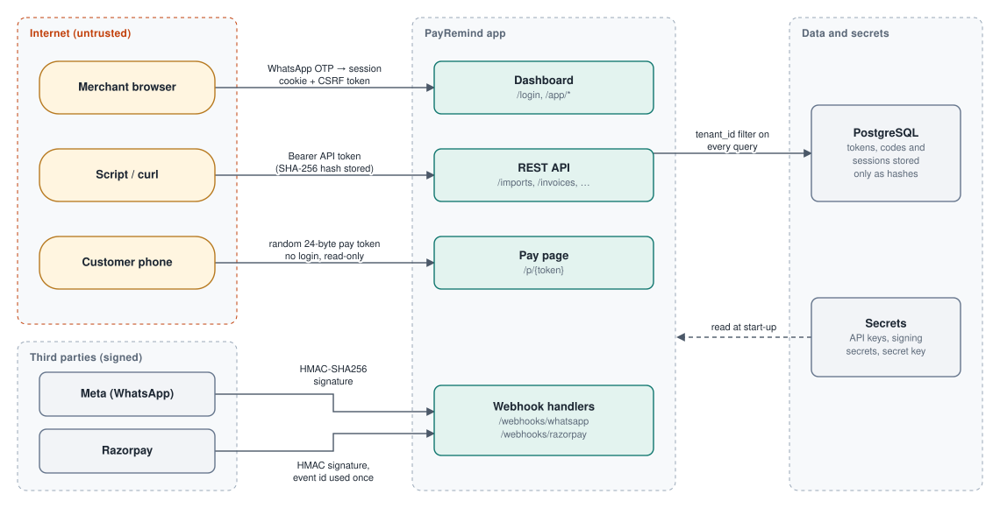

# Security and Compliance Notes

| | |
|---|---|
| Scope | PayRemind app at milestone M4, plus the planned AWS beta (M5) |
| Date | 26 Nov 2026 |
| Audience | Hari (owner, learning security architecture) and any reviewer |

> **⚖ Not legal advice.** Section 6 lists the legal, tax and regulatory assumptions. Each one
> needs a lawyer or chartered accountant to confirm before PayRemind charges money or opens to
> the public.

## 1. What we are protecting

| Asset | Why it matters | Where it lives |
|---|---|---|
| Merchants' customer lists (names, phones, amounts owed) | Personal data; commercially sensitive; a leak between merchants would end trust | `customers`, `invoices`, `promises`, `reminder_log` |
| Merchant accounts | Whoever controls one can message that merchant's customers | `users`, `web_sessions`, API tokens |
| The WhatsApp sender number and its quality rating | All merchants share it; spam or abuse could get it blocked | Meta Business account |
| Pay links | Point customers at a UPI ID; tampering could redirect money | `invoices.pay_token`, `tenants.upi_vpa` |
| API keys and secrets | Send messages, create subscriptions, forge sessions | Environment / Secrets Manager (M5) |
| GST invoices | Tax records | `billing_invoices` |

## 2. Trust boundaries

| Boundary | Who crosses it | Control in the code |
|---|---|---|
| Browser → dashboard | Merchant users | WhatsApp OTP (6 digits, 5 min, 5 tries, 3 per 15 min); HMAC-hashed codes; session cookie HttpOnly + Secure + SameSite=Lax; CSRF token on every POST; strict CSP; `X-Frame-Options: DENY` |
| Script → JSON API | Merchant integrations | Bearer token, 32 random bytes, stored as SHA-256 |
| Customer → pay page | Anyone with the link | 24-byte random token (not the invoice id); read-only; no scripts; `noindex`; `no-referrer` |
| Meta → webhook | Meta | HMAC-SHA256 of raw body checked in constant time before parsing; 256 KB limit |
| Razorpay → webhook | Razorpay | HMAC-SHA256 check; event id stored so retries are applied once |
| App → database | App code | Every query filtered by `tenant_id`; isolation tests are a launch gate |
| App → Meta / Razorpay APIs | App code | HTTPS with timeouts (10 s / 15 s); errors never echo provider responses |

## 3. Threat model (STRIDE)

STRIDE is a checklist of six threat types. For each, the main threat to PayRemind, what already
mitigates it, and what is left.

| Type | Threat | Mitigation in place | Remaining risk / to do |
|---|---|---|---|
| **S**poofing | Someone signs in as a merchant | OTP to the registered WhatsApp number; rate limits; same response for unknown numbers | SIM swap or a shared phone; add per-IP limits at WAF (M5); consider alerting the owner on new sign-ins |
| **S**poofing | Forged webhook marks a subscription active or opts people out | HMAC signatures on both webhooks | Keep secrets out of logs and code; rotate if leaked |
| **T**ampering | Attacker changes a merchant's UPI ID so payments go elsewhere | UPI ID set only by the operator at invite time; no route changes it | When a "change UPI ID" feature is added, require re-authentication and notify the owner |
| **T**ampering | Malicious spreadsheet (XML bombs, huge unzipped size) | 5 MB upload cap; 5,000-row cap; openpyxl read-only mode; generic error messages | Add `defusedxml`; cap uncompressed size; parse in a time-limited worker |
| **R**epudiation | Merchant disputes who marked an invoice paid or sent a reminder | Reminder log with provider message id | No audit log of user actions or sign-ins (gap G-1) |
| **I**nformation disclosure | One merchant reads another's data | Tenant-scoped queries; 404 for other tenants' ids; dedicated isolation tests for API and web | Keep the rule in code review; consider PostgreSQL row-level security as a second layer |
| **I**nformation disclosure | Pay link forwarded or guessed | 192-bit random token; only shows payee, invoice number, due date, amount | Links never expire; acceptable for beta, review later |
| **I**nformation disclosure | Database stolen | Tokens and codes hashed; RDS encryption with KMS (M5) | Customer names and phones are plain text; restrict access; backups encrypted |
| **D**enial of service | Flood of logins or uploads | Per-phone OTP limits; size and row caps | WAF rate rules (M5); Lambda concurrency limits; budget alarms catch cost attacks |
| **D**enial of service | Spam through our WhatsApp number damages its rating | Only invited merchants; templates only; STOP honoured globally | Enforce plan limits (gap G-3); watch the opt-out rate per merchant |
| **E**levation of privilege | Merchant user reaches operator functions | Operator functions exist only in the CLI on the server; no admin web routes | Keep it that way; protect server and AWS console with MFA |

## 4. Controls checklist (OWASP ASVS-style)

| Area | Status |
|---|---|
| Passwords | None used; phone OTP only ✓ |
| Session tokens random, hashed at rest, expire, revoked on logout | ✓ |
| CSRF protection on state-changing forms | ✓ |
| Output encoding (Jinja autoescape) and no reflected input in messages | ✓ (tests check escaping and fixed flash messages) |
| Content-Security-Policy with no scripts | ✓ |
| Security headers (nosniff, frame denial, referrer policy, no-store) | ✓ |
| Input size limits on uploads and webhooks | ✓ |
| Constant-time comparison of secrets | ✓ |
| Secrets from environment, not code | ✓ (Secrets Manager in M5) |
| Container runs as non-root | ✓ |
| Dependency scanning (pip-audit) and static analysis (bandit, mypy strict) in CI | ✓ |
| SAST (CodeQL or Semgrep) and DAST (OWASP ZAP) | Planned (launch gate) |
| Logging and monitoring of security events | Gap (G-1); CloudTrail/GuardDuty planned |
| API token rotation and expiry | Gap (G-2) |
| Account lockout alerting | Gap |
| Backups and tested restore | Planned (M5, launch gate) |

## 5. Incident response (outline)

A full runbook is a launch gate. The outline:

1. **Detect**: GuardDuty finding, budget alarm, merchant report, unusual opt-out spike, failed
   job.
2. **Triage within 1 hour**: what data, which merchants, still happening?
3. **Contain**: rotate the affected secret (WhatsApp token, Razorpay keys, `SECRET_KEY` which
   also invalidates pending codes), revoke sessions (`DELETE FROM web_sessions`), disable the
   daily job if messages are going wrong.
4. **Report**: CERT-In within 6 hours of noticing a reportable incident; notify affected merchants
   within the time the DPA promises (draft says 24 hours) so they can meet their own duties.
   **⚖ Verify** both.
5. **Recover**: restore from backup if data was changed; confirm with tests.
6. **Learn**: write up what happened and add a test or control.

## 6. Legal, tax and regulatory items to verify

These are planning assumptions found in the code and drafts. **None has been checked by a
professional.** Who to ask is in brackets.

| # | Assumption | Where it shows up | Ask |
|---|---|---|---|
| L-1 | Because customers pay the merchant's own UPI ID directly and PayRemind never handles funds, PayRemind is not a payment aggregator and needs no RBI authorisation | BRD BR-1, pay page | Lawyer familiar with RBI payment rules |
| L-2 | Under the DPDP Act 2023 and DPDP Rules 2025, the merchant is the data fiduciary and PayRemind is a data processor | DPA draft, BRD BR-7 | Lawyer |
| L-3 | Merchants have a lawful basis to send payment reminders to their customers on WhatsApp, and our templates qualify as "utility" messages | BRD, templates | Lawyer; Meta's policy pages |
| L-4 | A single global opt-out list across merchants is acceptable and expected | Opt-out design | Lawyer; Meta policy |
| L-5 | Data stored in India and passing through Meta's infrastructure is acceptable for this data | DPA §9 | Lawyer |
| L-6 | CERT-In directions require reporting certain incidents within 6 hours and keeping logs for 180 days, and apply to PayRemind | NFR-6, NFR-10, PLAN | Lawyer |
| L-7 | GST registration timing (threshold), 18% rate, SAC 998314, CGST+SGST vs IGST by state, invoice numbering (max 16 characters, one series per financial year) | `billing/gst.py` | Chartered accountant |
| L-8 | How long GST records and invoices must be kept | Data model §5 | Chartered accountant |
| L-9 | Showing prices "+ GST" and charging GST-inclusive amounts through Razorpay is presented correctly | Billing page, tech spec §4.4 | Chartered accountant |
| L-10 | Privacy policy, terms and DPA drafts are adequate (fill in bracketed items) | `/privacy`, `/terms`, `docs/legal/dpa.md` | Lawyer |
| L-11 | Razorpay's terms allow this use for subscriptions | Billing | Razorpay onboarding team |

## 7. Suggested next security work, in order

1. Add structured logging and an audit table (G-1). It helps both incidents and debugging.
2. Add `defusedxml` and an uncompressed-size cap for `.xlsx` (G-6).
3. Fail fast if `SECRET_KEY` is unset in production (G-10); token rotation command (G-2).
4. Enforce plan limits to protect the shared WhatsApp number (G-3).
5. Turn on CodeQL in GitHub and run OWASP ZAP against a local instance.
6. Write the incident runbook and test a backup restore during M5.
7. Consider PostgreSQL row-level security on tenant tables as defence in depth.
